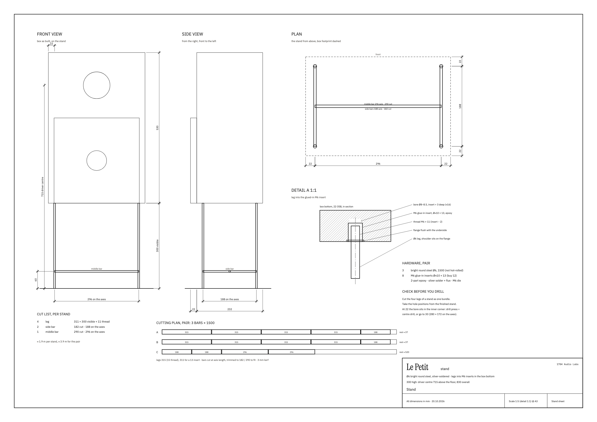

# Stand

Four legs, two side bars and a middle bar of **Ø 6 mm bright round steel**, silver-soldered into one
H-frame. The legs screw into M6 inserts glued into the box bottom, so the box can't slide or tip off.
300 mm high: the driver centre sits at **715 mm** above the floor, the whole speaker at 830 mm.

[Open the stand sheet (SVG)](plans/stand-plan.svg) · [see it in 3D](3d-model.md) · generator:
[make_stand_plan.py](plans/make_stand_plan.py)

## Why this shape

- **300 mm, not the golden section's 330:** the doubler is 300 × 300 and sits flush with the bottom —
  a 300 square of wood above a 300 high open frame.
- **Legs on the corners, bars low:** from the listening seat you see four thin uprights; the H of bars
  60 mm above the floor ties the four legs into one part, which is what makes the frame stand.
- **No top frame:** the box rests on four points, and four equal legs always sit in one plane. A top
  frame would have to be flush with the leg ends to a tenth of a millimetre, or the box rocks.

## Cut list

| Per stand | Part | Length | Note |
| ---: | --- | --- | --- |
| 4 | leg | **311** | 300 visible + 11 thread (for a 13 mm insert) |
| 2 | side bar | **182** | 188 on the axes, front leg to back leg |
| 1 | middle bar | **290** | 296 on the axes, between the side bars' middles |

≈ 1.9 m per stand, ≈ 3.9 m for the pair: **3 bars of 1500 mm**, cut like this (3 mm kerf allowed):

| Bar | Cuts | Rest |
| --- | --- | --- |
| A | 315 · 315 · 315 · 315 · 188 | ≈ 37 |
| B | 315 · 315 · 315 · 315 · 188 | ≈ 37 |
| C | 188 · 188 · 296 · 296 | ≈ 520 — for a test piece to practise threading and soldering |

Leg length = 300 + thread length, and thread length = insert length − 2. Cut the legs 315 and face
them to length once you have the inserts.

## Hardware (pair)

| Qty | Item |
| ---: | --- |
| 3 | bright-drawn round steel Ø 6 mm, 1500 long — not hot-rolled: its scale and tolerance give neither a clean M6 thread nor a tight fit |
| 8 | M6 glue-in inserts (knurled sleeve, Ø ≈ 10, 12–13 long, with a flange); buy 12. A screw-in insert with a flange (Rampa type SK) works too |
| | 2-part epoxy, silver solder and flux, an M6 die |

## Building it

1. **Cut the four legs of a stand as one bundle** — taped together, cut once, both ends faced. Half a
   millimetre of difference and the box rocks; with no top frame there is nothing to take it up.
2. **Thread** the top 11 mm of every leg M6 (for a 13 mm insert). The thread must be shorter than the
   insert, so the leg's shoulder lands on the flange and not the thread on the bottom of the hole.
3. **Solder** each side bar between a front and a back leg, 60 mm above the floor (188 on the axes),
   then the middle bar between the two side bars' middles (296 on the axes). Check the four leg ends
   on a flat plate before the solder sets.
4. **Mark the holes from the finished stand,** not from the drawing — after six soldered joints the
   296 × 188 may be a millimetre off, and the holes have to fit the stand.
5. **Drill** Ø 8–8.5 (the insert maker's table), depth = insert + 3 ≈ 16, with a depth stop. At 22 mm
   from both outside faces the hole sits exactly in the inner corner — half in the bottom panel, half
   in the end grain of side and front. Use a drill press and a centre drill; or move to 30 mm, then
   the insert sits fully in the bottom panel and the stand becomes 280 × 172 on the axes.
6. **Glue the inserts in with epoxy,** flange flush with the underside. Screwed alone, a thread in
   OSB works loose over time — and the insert is the only connection between steel and wood.
7. **Screw the legs in** until the shoulders sit on the flanges.

## In the room

The stand lifts the driver to 715 mm. With the listening seat at ear height ≈ 1000 mm and 2.5 m away
the driver is about 6.5° below the axis — a 10 cm cone loses only one or two decibels at 10 kHz. The
floor bounce moves up with the lower driver, to around 330 Hz: a thick rug at the reflection point,
about 1 m in front of the speaker, takes it out.
